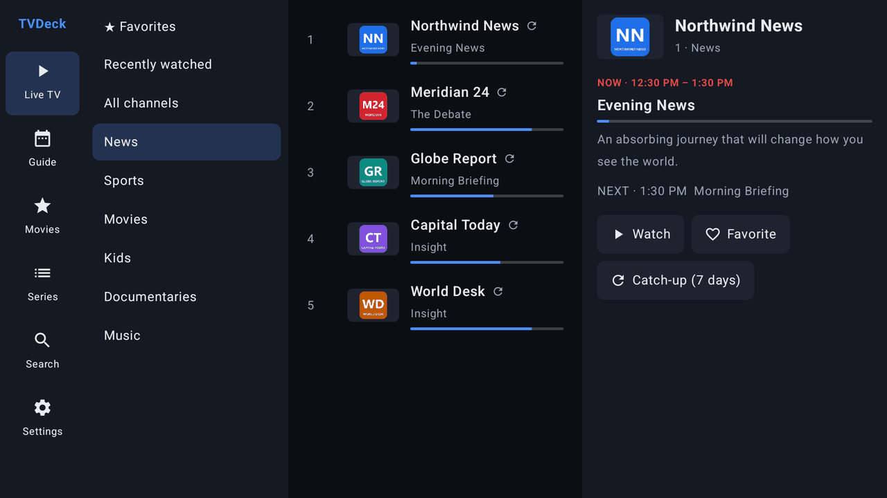
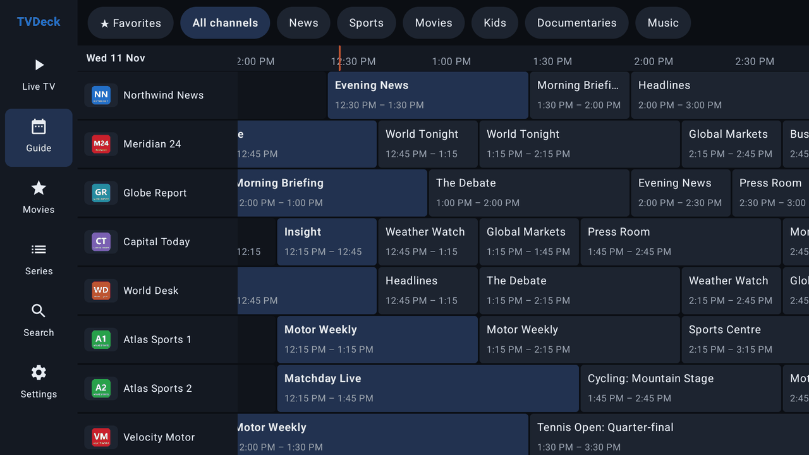
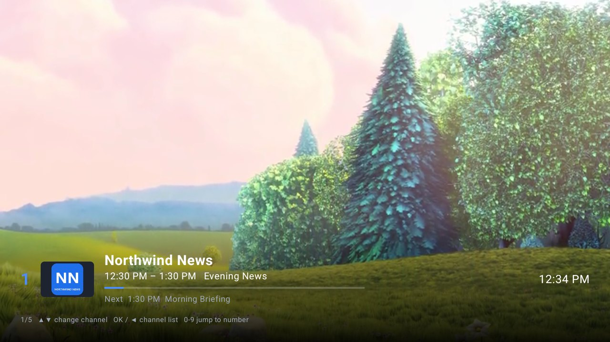
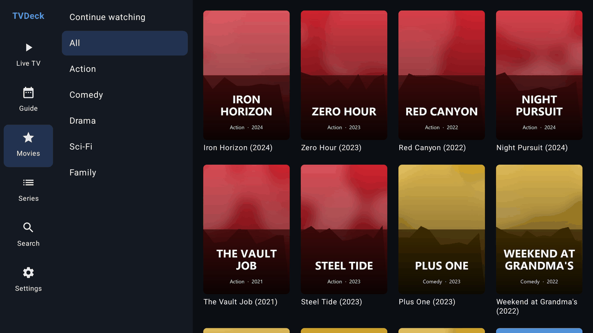
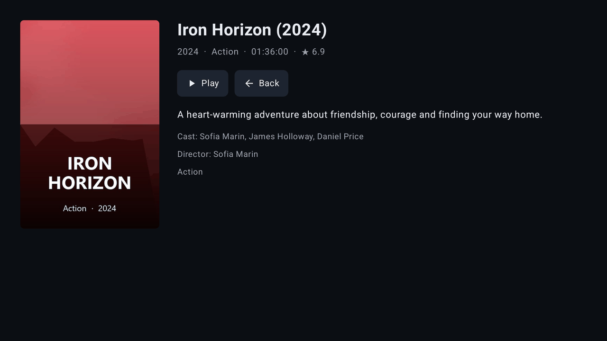
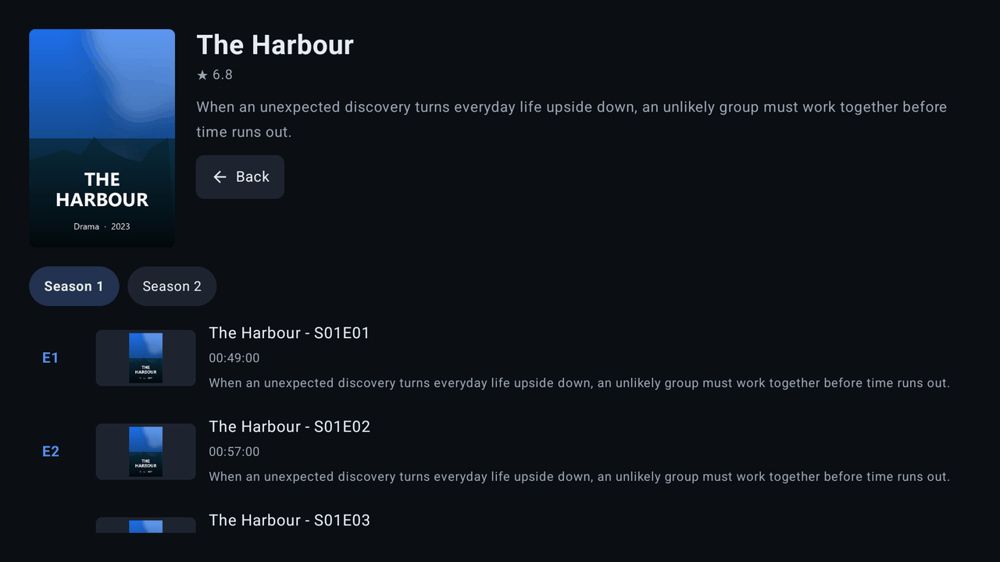
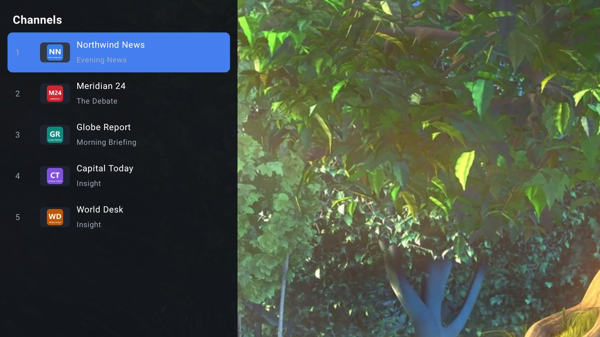
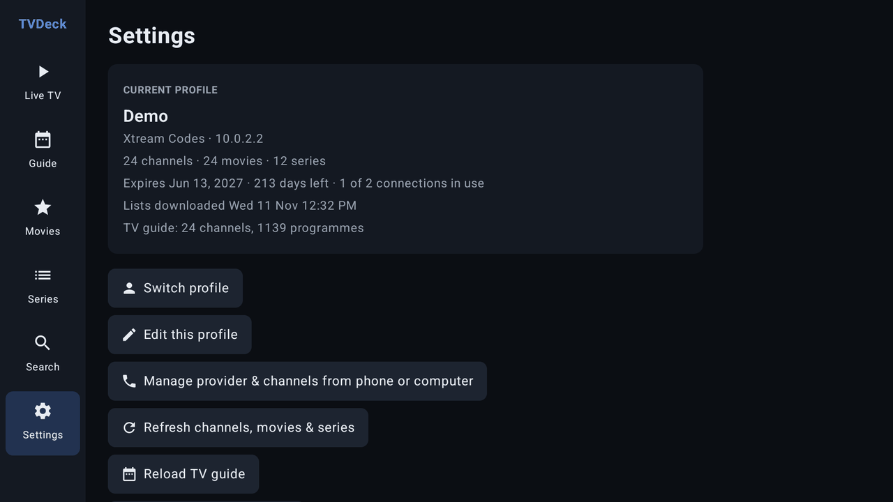
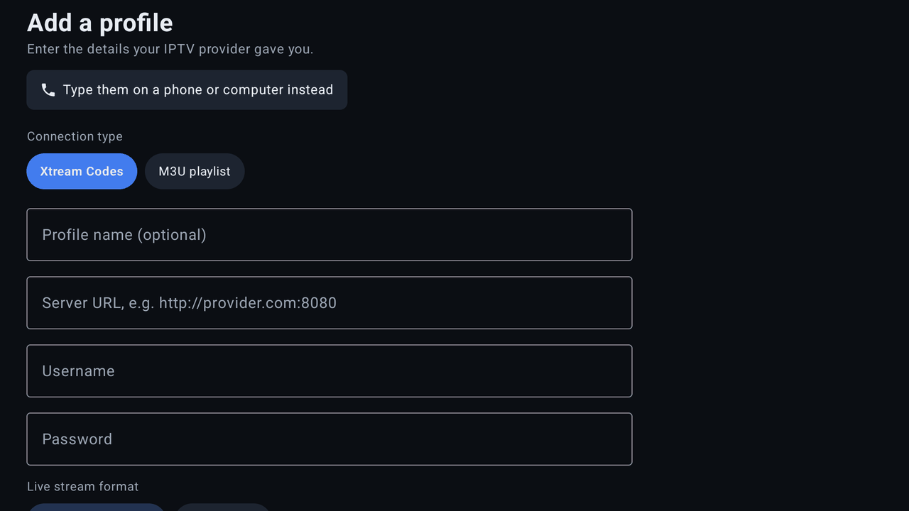

# TVDeck — IPTV player for Android TV boxes and phones

TVDeck is an IPTV player in the style of MYTVOnline: you add your provider's details and it
gives you Live TV with a TV guide, Movies, Series and catch-up. It works with a TV remote
(D-pad) on Android TV boxes and with touch on phones and tablets.

TVDeck doesn't include any channels or streams. It plays whatever your own IPTV subscription
or playlist provides.

## Screenshots



<table>
  <tr>
    <td width="50%"><br><sub><b>TV Guide</b>: channels down the side, 26 hours across</sub></td>
    <td width="50%"><br><sub><b>Player</b>: now/next banner over the live stream</sub></td>
  </tr>
  <tr>
    <td><br><sub><b>Movies</b>: poster grid by category</sub></td>
    <td><br><sub><b>Movie details</b>: plot, cast, rating</sub></td>
  </tr>
  <tr>
    <td><br><sub><b>Series</b>: seasons and episodes</sub></td>
    <td><br><sub><b>Channel list</b> without leaving the player</sub></td>
  </tr>
  <tr>
    <td><br><sub><b>Settings</b>: account expiry, connections, refresh</sub></td>
    <td><br><sub><b>First run</b>: Xtream Codes or M3U</sub></td>
  </tr>
</table>

<sub>Screenshots use a made-up demo provider: the channels, programmes, movies and series are fictional.</sub>

## Features

- **Two connection types**
  - **Xtream Codes**: server URL + username + password (live TV, movies, series, guide, catch-up).
  - **M3U / M3U8 playlist URL**, with an optional XMLTV guide URL.
- **Multiple profiles**: add several providers and switch between them.
- **Live TV**: categories, channel list with what's on now and a progress bar, info panel with
  now/next, favorites, recently watched.
- **TV Guide (EPG)**: classic grid with channels down the side and 26 hours across the top.
  Gzipped XMLTV (`.xml.gz`) is supported.
- **Catch-up / timeshift**: replay past programmes (and "start over" the current one) on channels
  where your provider keeps an archive. Supports Xtream timeshift and the common M3U modes
  (`default`, `append`, `shift`, `flussonic`, `xc`).
- **Movies & Series**: poster grids by category, details (plot, cast, year), seasons and episodes,
  resume where you left off, auto-play next episode, "Continue watching".
- **Search** across channels, movies and series.
- **Player** (ExoPlayer / Media3): HLS and MPEG-TS, auto-reconnect for live streams,
  number keys to jump to a channel, channel list overlay.
- Works offline from cache if the provider is briefly unreachable.

## Managing the provider and channels from a phone or computer

Typing a server URL and password with a remote is slow, so TVDeck has a small web manager where
you can set up your IPTV provider **and** choose your channels on the same page:

1. On the TV, open **Settings → Manage provider & channels from phone or computer**. It's also on
   the first-run setup screen (**Type them on a phone or computer instead**) and on the profile
   list (**Set up from phone or computer**).
2. On a device on the same network, open the address shown and enter the PIN.
3. **Provider** tab: add, edit or delete providers (Xtream Codes or M3U), and pick which one the TV
   uses. Saved passwords and M3U playlist URLs are never shown in the browser. Leave those fields
   blank to keep what's saved.
4. **Live TV / Movies / Series** tabs: untick groups (or, under **Channels**, single live channels),
   then press **Save & apply**.
5. **Live TV → Edit order & names**: move groups and channels with ▲ ▼, rename channels (clear a name
   to go back to the provider's), and optionally number channels 1, 2, 3… in your order. Renamed
   channels still match the TV guide. **Reset order & names** undoes it all.
6. **Live TV → Combine channels**: search for channels that show the same thing (say *DAZN 1* and
   *DAZN Sports 1*, even from different groups), add them in the order to try them, and press
   **Combine**. They become one channel in the first one's group and position: if it stops working,
   the next one takes over automatically. **Split** undoes it, and also works on HD/FHD versions
   that were combined automatically.

## Account, automatic refresh and reminders

- **Account info** (Xtream Codes): expiry date, days left and connections in use are shown in
  Settings and in the manager. They turn red when less than a week is left.
- **Automatic refresh**: while TVDeck is open it downloads channels, movies, series and the guide
  again in the background (daily by default; 12 h, 6 h or off in Settings or the manager). The
  screen isn't cleared while it loads, and it waits while you're watching. If the provider can't be
  reached, the saved lists stay and Settings says so.
- **Programme reminders**: in the TV guide, choose a programme that hasn't started and press
  **Remind me**. A minute before it starts, a popup offers **Watch**, even over the player. If TVDeck
  is in the background or closed, you get a notification instead; tap it to go straight to the
  channel. Reminders survive a restart of the box. See or cancel them in **Settings → Reminders**.

Switched-off groups aren't kept in memory and their guide data is dropped. If every group in a
section is off (all movies, say), an Xtream provider's list for it isn't downloaded at all. Groups
your provider adds later start switched on. The manager only runs while that screen is open.

## Remote control (Android TV)

| In the live player | Action |
|---|---|
| ▲ / ▼ (or CH+ / CH−) | Previous / next channel |
| OK | Show info; press again for the channel list |
| ◀ or Menu | Channel list |
| 0–9 | Type a channel number to jump to it |
| Back | Leave the player |

In movies and episodes: ◀ / ▶ skip back 10 s / forward 30 s, OK shows the controls.

On phones: tap to show info, swipe up/down to change channel, long-press a channel for its
info and catch-up.

## Download

Get the latest APKs from the [**Releases**](https://github.com/Nervous-Panda/TVDeck/releases/latest) page:

| File | For |
|---|---|
| `TVDeck-<version>.apk` | Android TV boxes, phones and tablets |
| `TVDeck-Car-<version>.apk` | Phones, with the Android Auto screen (see [In the car](#in-the-car-android-auto-experimental)) |

## Installing on your devices

- **Phone/tablet**: copy the APK to the device and open it. Allow "Install unknown apps" for
  your file manager or browser when asked.
- **Android TV box** (Formuler, Nvidia Shield, Chromecast with Google TV, Fire TV…):
  - Put the APK on a USB stick and open it with the box's file manager, **or**
  - Upload the APK somewhere you can reach and use the free **Downloader** app to fetch it, **or**
  - Use "Send Files to TV" from your phone.
  - Enable "Unknown sources" / "Install unknown apps" for the app you use to open the APK.

On first launch, choose **Xtream Codes** or **M3U playlist**, enter the details from your
provider, and press **Save & connect**.

## In the car (Android Auto, experimental)

The **car** APK (`TVDeck-Car-<version>.apk`, shown as *TVDeck Car*) is the normal phone app plus a screen on
the Android Auto display: pick a group (Favorites first), tap a channel, and it plays on the car screen.
Tap the video for the channel name, ▲ ▼ to change channel and ← to go back. It installs next to the
normal app; set up your provider in it on the phone first.

It uses Google's unofficial Android Auto SDK (the same one Fermata Auto uses), so Android Auto only shows
it if it looks installed from the Play Store. On a phone without root, install it with **KingInstaller**
using its **Shizuku** method, or use a dongle with a developer mode (e.g. AAWireless). Then enable it in
Android Auto → *Customize launcher*. Android Auto updates can break this at any time, and whether video
keeps playing while driving depends on Android Auto and the car.

## Project layout

```
app/src/main/java/com/tvdeck/app/
  model/      data classes (Channel, Programme, VodItem, …)
  data/       M3U parser, XMLTV parser, Xtream Codes API, catch-up URLs, cache, storage
  player/     PlayerActivity + PlayerController (Media3 ExoPlayer)
  ui/         Compose screens: Live TV, Guide, Movies, Series, Search, Settings, Profiles
app/src/car/  Android Auto screen (car build only); libs/aauto.aar is the Android Auto SDK
```

Built with Kotlin, Jetpack Compose, Media3 ExoPlayer, OkHttp and Coil. Minimum Android 5.0
(API 21), targets Android 15.

## Notes

- Release builds are signed with the debug key so they install directly. If you ever publish
  the app, set up your own signing key.
- Profiles (including passwords) are stored only on the device, in the app's private storage.

## Credits

- Co-developed with [Claude](https://claude.ai) by Anthropic.
- [Fermata](https://github.com/AndreyPavlenko/Fermata) by Andrey Pavlenko (GPL-3.0). TVDeck's
  Android Auto support follows Fermata Auto's approach: `app/libs/aauto.aar` is taken from the
  Fermata repository, and the car build's manifest uses the same declarations.
- `aauto.aar` is Google's unofficial Android Auto SDK. It is not covered by TVDeck's license and
  remains the property of its owners.
- The video in the player screenshots is from *Big Buck Bunny* (© Blender Foundation,
  [CC BY 3.0](https://creativecommons.org/licenses/by/3.0/)).

## License

Copyright (C) 2026 NervousPanda

TVDeck is free software: you can redistribute it and/or modify it under the terms of the GNU
General Public License as published by the Free Software Foundation, either version 3 of the
License, or (at your option) any later version. It is distributed in the hope that it will be
useful, but WITHOUT ANY WARRANTY. See [LICENSE](LICENSE) for the full text.
